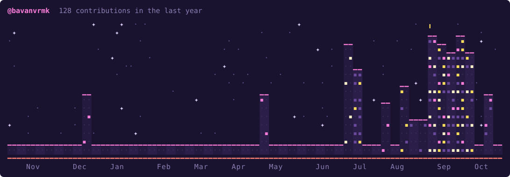

<p align="center">
  
</p>

<div align="center">

[](https://github.com/bavanvrmk)

<br>

[](https://bavanvrmk.github.io)
[](https://github.com/bavanvrmk)
[](https://www.linkedin.com/in/bavan-vijaya-raja-m-k-1a9319379/)

<br><br>

```text
┌─[ SYS://CORE_TELEMETRY ]────────────────────────────────────────────────────┐
│  ◈ IDENTITY: bavan@cce     │ ⬡ AFFILIATION: amrita.cbe │ ⌬ STATUS: NOMINAL │
│  ◈ ARCH: ARM & Linux       │ ⬡ THEME: SYNTHWAVE_NEON   │ ⚡ UPTIME: 99.9%   │
└─────────────────────────────────────────────────────────────────────────────┘
```

</div>

---

## `◈ 0x01 // ABOUT`

I'm a **Computer & Communication Engineering** student at **Amrita Vishwa Vidyapeetham, Coimbatore**, interested in the places where hardware and software meet.

Currently exploring:

- ✦ Embedded systems & microcontrollers
- ✦ ARM architecture & assembly
- ✦ Operating systems
- ✦ Data structures & algorithms
- ✦ Artificial intelligence & machine learning
- ✦ Robotics

I enjoy building things that are not only functional, but also understandable — from low-level systems to applied AI.

---

## `◈ 0x02 // TECH_MATRIX`

```text
┌──[ 0x02.0 // TECH_MATRIX ]─────────────────────────────────┐
│ ◈ LANGUAGES   │ C · Python · ARM Assembly                  │
├───────────────┼────────────────────────────────────────────┤
│ ⬡ SYSTEMS     │ Embedded · Microcontrollers · OS           │
├───────────────┼────────────────────────────────────────────┤
│ ⌬ DATA / AI   │ Statistics · scikit-learn · ML             │
├───────────────┼────────────────────────────────────────────┤
│ ⬢ HARDWARE    │ Raspberry Pi · Embedded Interfacing        │
├───────────────┼────────────────────────────────────────────┤
│ ⚙ TOOLS       │ Git · Linux                                │
└───────────────┴────────────────────────────────────────────┘
```

<div align="center">

[](https://skillicons.dev)

</div>

---

## `◈ 0x03 // SELECTED_PROJECTS`

### ◈ `[0x01] LiveWatch`

> **`// Multicore debugging · Embedded Hardware · UART`**  
> A plug-and-play open hardware watchpoint module for debugging multicore systems. Designed to passively observe memory-bus writes and stream timestamped variable changes to a host system.  
>  
> `✦ embedded` `✦ uart` `✦ debugging`  
>  
> [**➜ [ access repository ]**](https://github.com/bavanvrmk)

---

### ◈ `[0x02] E-Yantra PacBot`

> **`// Robotics · Embedded C · PID · Path Planning`**  
> A Pac-Man-inspired micromouse-style robot built for the **E-Yantra robotics competition**, focused on real-time maze navigation, motion control and path planning.  
>  
> `✦ robotics` `✦ pid` `✦ path-planning`  
>  
> [**➜ [ access repository ]**](https://github.com/bavanvrmk)

---

### ◈ `[0x03] Smart Cataloging — SIH 2026`

> **`// AI · Computer Vision · Voice · Smart Pricing`**  
> An AI-driven platform designed to help artisans create digital product catalogs through image and multilingual voice input, with automated listing generation and intelligent pricing.  
>  
> `✦ ai` `✦ computer-vision` `✦ multilingual`  
>  
> [**➜ [ access repository ]**](https://github.com/bavanvrmk/ArtisanWorkspace)

---

## `◈ 0x04 // GITHUB_TELEMETRY`

<div align="center">



<br><br>

<a href="https://github.com/bavanvrmk">
  
</a>
<a href="https://github.com/bavanvrmk">
  
</a>

<br><br>

<a href="https://github.com/bavanvrmk">
  
</a>

</div>

---

## `◈ 0x05 // CURRENT_PIPELINE`

```text
┌─[ 0x05 // /current ]───────────────────────────────────────┐
│                                                            │
├── ◈ → exploring a new domain                               │
├── ◈ → learning Operating Systems                           │
├── ◈ → working with Processor Designs                       │
├── ◈ → experimenting with AI / ML                           │
└── ◈ → building things that are actually useful             │
└────────────────────────────────────────────────────────────┘
```

---

## `◈ 0x06 // I/O_CHANNELS`

```text
┌─[ 0x06 // CONNECT ]────────────────────────────────────────┐
│  ◈ github      → github.com/bavanvrmk                      │
│  ◈ portfolio   → bavanvrmk.github.io                       │
│  ◈ linkedin    → linkedin.com/in/bavan-vijaya-raja-m-k-1a9319379/
└────────────────────────────────────────────────────────────┘
```

<div align="center">

### `bavan@cce:~$ exit_ 0`

*Living life to its fullest.*

<br>


</div>
